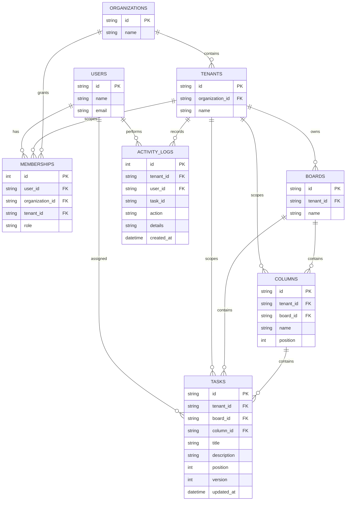

# Entity relationship diagram

Indexes prioritize tenant filtering and ordered task retrieval. In a production PostgreSQL schema, consider composite foreign keys to guarantee `(tenant_id, board_id)` and `(tenant_id, column_id)` consistency at the database layer, plus row-level security policies.
